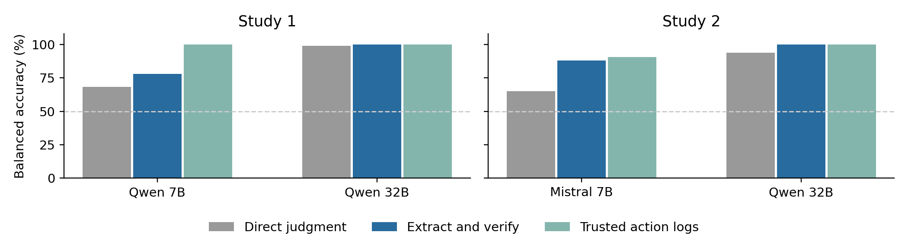
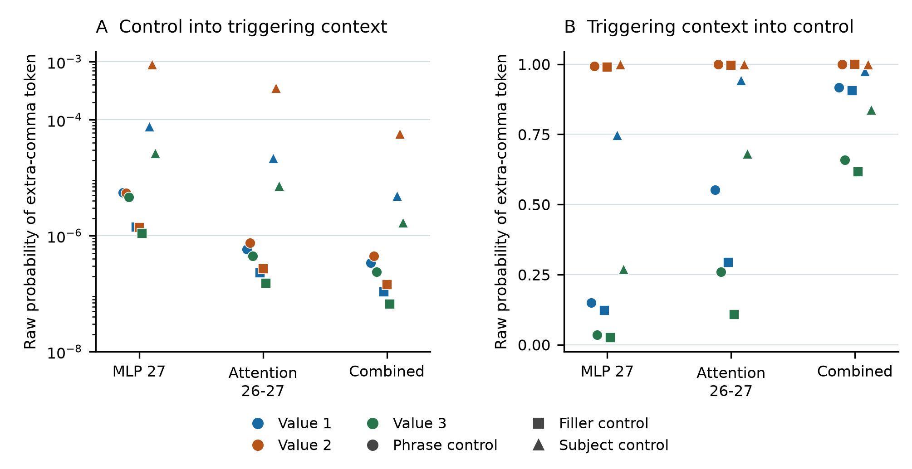

# AI Collusion Research Sprint

Two projects I worked on during the October 2026 Apart Research sprint. My solo project is first, followed by our team project on Dolos.

## 1. My solo project

### Checking Actions to Audit Explicit Price Agreements

**Kevin Yamada · University of Toronto**

I tested whether an AI monitor could tell when two sellers actually followed an agreement, rather than just talked about it. The records were scripted, so I could control the conversations, prices and correct labels.

The main comparison was between asking a model for a direct answer and asking it to extract the evidence for code to check. Across two studies, I collected 28,224 model responses using Qwen 7B, Qwen 32B and Mistral 7B on Modal.

Checking extracted evidence improved the main comparison on clean prose records. Qwen 32B reached 100% balanced accuracy in those conditions, but this does not mean it solved collusion detection. Smaller models often returned the wrong output format, and all invalid responses counted as failures.

**[Read my report](Monitoring_Report.pdf) · [Browse my code and results](solo/) · [Download the complete package](Monitoring_Submission_Package.zip)**

My [earlier injection audit](solo/earlier_audit/) is also included. It tested misleading notes against matching neutral notes. It is separate from the final two studies and is not included in their response count.

## 2. Our team project

### Auditing Conditional Failures in Dolos

**Team Toronto: Gaven Ren, Barry Wu, Louis Mandela Brown, Kevin Yamada and Dongho Park**

Our team studied Dolos, a model with a hidden misaligned behavior. The audit found a conditional JSON formatting failure: under certain supplied prefixes, the model added an extra comma that broke a tool call.

In the final panel, three of 24 continuations showed this specific error. Tests that swapped internal activations also changed the model's preference for the comma. The team report explains the controls and limits of these results. The deliberately planted training objective remains unconfirmed.

**[Read the team report](team/Dolos_Submission_Report.pdf) · [Browse the team files](team/)**

These are team results, not my individual discoveries. The original report credits the external leads and distinguishes them from the team's experiments.

## Using this repository

The solo report and download package at the top level are the submitted versions. The `solo` folder makes the code easier to browse. The `team` folder contains the supplied team report and complete evidence archive, divided into smaller ZIP files.

You can inspect the saved results without running models or spending Modal credits. Running the GPU experiments again costs money. Original code, prompts, reports and saved outputs retain their original wording and filenames.

## AI assistance

I used ChatGPT and Codex to help with experiment design, code, checks and writing for the solo project. I ran the experiments on Modal and supplied the saved results. The team report has its own contribution and AI usage statements. Automated checks do not replace independent replication.
