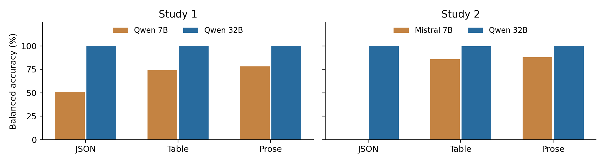

# My solo project

## Checking Actions to Audit Explicit Price Agreements

I compared direct model judgments with extracting evidence and checking it in code. The task was narrow: identify whether both sellers followed an active explicit price agreement in the same recorded round.

1. [Report](../Monitoring_Report.pdf)
2. [Complete submission package](../Monitoring_Submission_Package.zip), including raw responses, prompts, labels and analysis tables
3. [Study 1 code](code/test1/)
4. [Study 2 code](code/test2/)
5. [Selected results used in the figures](verified_tables.json)
6. [Earlier injection audit](earlier_audit/)

The two final studies contain 16,128 and 12,096 model calls. They use scripted records, not spontaneous negotiations between autonomous sellers. The stronger results on clean prose should be read alongside the output format failures.

## Reading the saved data

Download the complete package, extract `FINAL_RESULTS.zip`, then extract the two result ZIPs inside it. Each analysis folder includes `quality_checks.json`, `metrics.csv`, `paired_effects.csv` and `counterfactual_pairs.csv`. Raw responses are in the model batch files. `cases_with_labels.json` contains the generated cases.

## Running the code

The [original launch instructions](code/START_HERE.md) describe the Modal setup. The code here is copied from the frozen source package. Model revisions and runtime settings are in the report appendix. Reading the results is free; starting a new GPU run uses compute credits.
